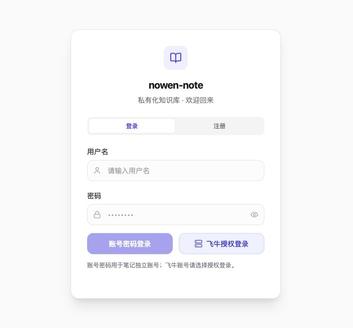

# Nowen Note fnOS

Self-hosted notes and an AI knowledge base adapted for Feiniu fnOS NAS.

[中文说明](./README.md) · [fnOS deployment](./docs/fnos-deployment.md) · [GPL-3.0](./LICENSE)

## Origin and AI assistance

Adapted from [cropflre/nowen-note](https://github.com/cropflre/nowen-note) **v1.5.3**, with upstream baseline `91ffdd9`. The upstream license and copyright notices are retained. This fork's first consolidated release is **v1.5.4**.

All post-handoff analysis, code changes, testing, documentation and deployment work was carried out with AI assistance. Review your deployment configuration and verify the installed application.

## v1.5.4 changes

| Area | Changes |
| --- | --- |
| Home and search | Quick capture, AI organization, voice input and compact settings; dedicated search results with relevance, highlights and return navigation. |
| fnOS sign-in | App-gateway SSO, a unified password/fnOS authorization page, desktop session recovery, and gateway/direct-service connections. |
| AI settings | Shared provider channels, custom authentication headers, and separate chat, embedding, speech and multimodal selections. |
| Smart collection | Text and images submitted with an instance-specific token; server filtering, filing, related-note appends, original retention, image descriptions and actionable logs. |
| UI and reliability | Refined branding, navigation, dialogs and inputs; clearer sync conflicts, merge/undo, trash and sharing behavior. |

## Sign-in page

Captured from an isolated local demonstration without real accounts, server addresses or credentials.



## Deploy on fnOS

Build from this repository's latest source. Upstream images do not contain this fork's changes.

```bash
git clone https://github.com/quyanchun/nowen-note-fnos.git
cd nowen-note-fnos
# Use linux/arm64 for an ARM64 NAS.
docker buildx build --platform linux/amd64 --load -t local/nowen-note-fnos:1.5.4 .
docker save local/nowen-note-fnos:1.5.4 | gzip > nowen-note-fnos-1.5.4-image.tar.gz
python3 scripts/fpk/build-private-fpk.py --fnpack /path/to/fnpack --image local/nowen-note-fnos:1.5.4
```

Upload the image archive and generated FPK to your NAS. Import the image first:

```bash
gzip -dc nowen-note-fnos-1.5.4-image.tar.gz | sudo docker load
```

Install the FPK using fnOS App Center's manual installation, allow the intended users, and open the app from the NAS desktop. Preserve existing data when updating. The package retains `/app/nowen-note-private/`; its optional web listener binds to loopback by default. See the [deployment guide](./docs/fnos-deployment.md) for an independent HTTPS web/API entry. No system Nginx changes are required.

### Let an AI assistant deploy it

Give an AI assistant with terminal and NAS access this repository and the following instruction:

> Read AGENTS.md and docs/fnos-deployment.md. Deploy the latest source to my fnOS NAS. Check CPU architecture, Docker, ports and existing data; build matching image and FPK, upload/install them, and verify sign-in, saving, synchronization and collection. Preserve existing entry points and data, and do not edit system Nginx. Ask for missing connection information. Keep credentials in local secure storage, never in Git, source, documentation or logs. Report the actual installed version and acceptance results.

The assistant needs your own connection details and authorization; system security prompts and installation agreements may require your participation.

## Configure AI and collection

Configure your own provider channels and models in Settings → AI Assistant. In Clipboard Integration, select gateway or direct-service mode and copy that instance's endpoint and token.

A direct note service accepts its address and collection token. fnOS `/app/` additionally requires a valid fnOS session; the collection token does not bypass the gateway. Logs provide delete, force-collect and undo actions. Online models may receive submitted content, images or retrieval excerpts according to your configuration.

## Development

```bash
npm ci
npm --prefix backend ci
npm --prefix frontend ci
npm run dev
```

Build with `npm run build:all`. Test with `npm --prefix backend test` and `npm --prefix frontend run test:run`. See [development updates](./docs/dev-deploy.md) for existing installations.

No shared accounts, model credentials or personal NAS configurations are supplied. Each installation owns its configuration. See [LICENSE](./LICENSE).
