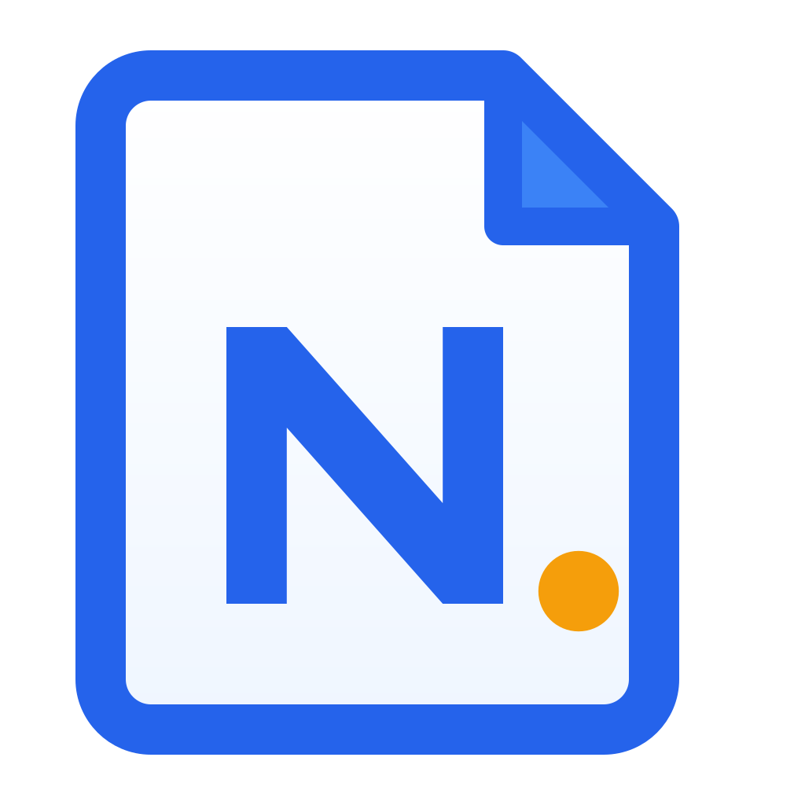
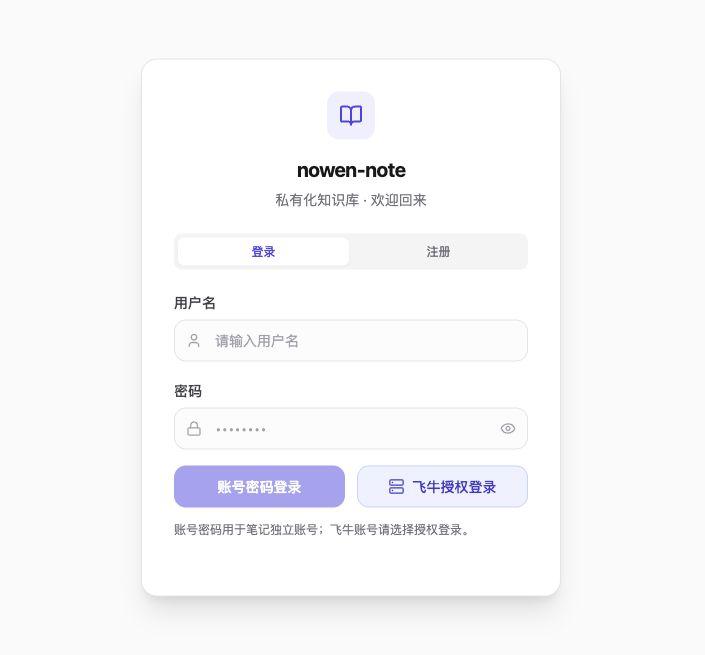

<div align="center">
  
  <h1>Nowen Note fnOS</h1>
  <p>面向飞牛 NAS 的自托管笔记与 AI 知识库</p>
  <p><a href="./README.en.md">English</a> · <a href="./docs/fnos-deployment.md">飞牛部署说明</a> · <a href="./LICENSE">GPL-3.0</a></p>
</div>

## 项目来源

基于 [cropflre/nowen-note](https://github.com/cropflre/nowen-note) **v1.5.3** 改造，上游接手基线为 `91ffdd9`。保留原项目的 GPL-3.0 许可证与版权声明。本仓库独立版本为 **v1.5.4**，以飞牛 fnOS 部署、登录和日常使用体验为主要改造方向。

**接手后的需求分析、代码改造、测试、文档和部署工作，全程由 AI 辅助完成。** 使用者仍需检查自己的部署配置与实际运行结果。

## 本次改造 · v1.5.4

| 模块 | 改造内容 |
| --- | --- |
| 首页与搜索 | 集成随手收集、AI 整理、语音输入及轻量设置；搜索使用独立页面，显示相关度与命中高亮，支持从详情返回结果。 |
| 飞牛登录 | 接入 fnOS 应用网关单点登录；统一账号密码与飞牛授权登录页，支持桌面端会话恢复，以及 NAS 网关／独立笔记服务两种连接方式。 |
| AI 配置 | 统一厂商渠道、认证与自定义请求头；分别选择对话、Embedding、语音和多模态模型，改进模型下拉与连接诊断。 |
| 智能收集 | 地址加专用 Token 提交文本和图片，由服务端过滤、整理、归档并保留原文；支持同类追加、图片描述、日志、强制收集及撤销。 |
| 样式与可靠性 | 调整首页品牌区域、导航、弹框与输入框样式；改进同步冲突说明、合并与撤销、回收站和分享行为。 |

## 登录页

账号密码和飞牛授权登录统一在同一页面。截图来自隔离的本地演示环境，不含真实账号、服务器地址或凭据。



## 部署到飞牛 NAS

需要飞牛 fnOS、Docker，以及与 NAS CPU 架构匹配的镜像。**使用本仓库最新源码构建**；原项目镜像不包含这里的改造。

1. 获取源码：

   ```bash
   git clone https://github.com/quyanchun/nowen-note-fnos.git
   cd nowen-note-fnos
   ```

2. 构建镜像（以下为 x86-64 NAS；ARM64 改为 `linux/arm64`）：

   ```bash
   docker buildx build --platform linux/amd64 --load \
     -t local/nowen-note-fnos:1.5.4 .
   docker save local/nowen-note-fnos:1.5.4 | gzip > nowen-note-fnos-1.5.4-image.tar.gz
   ```

3. 准备飞牛官方 `fnpack` 工具，生成应用包：

   ```bash
   python3 scripts/fpk/build-private-fpk.py \
     --fnpack /path/to/fnpack \
     --image local/nowen-note-fnos:1.5.4
   ```

4. 将镜像归档和生成的 `.fpk` 上传到自己的 NAS。**先在 NAS 导入镜像**，再通过「应用中心 → 手动安装」安装 FPK：

   ```bash
   gzip -dc nowen-note-fnos-1.5.4-image.tar.gz | sudo docker load
   ```

5. 启动应用，在飞牛应用权限中允许对应用户访问，然后从飞牛桌面打开。已有安装应继续使用原数据目录；无需修改系统 Nginx。

应用包沿用 `/app/nowen-note-private/` 网关前缀，使用独立应用用户和持久化数据目录。默认额外网页端口仅绑定回环地址；如需独立网页／剪贴板入口，请按[完整部署说明](./docs/fnos-deployment.md)显式配置自己的地址及 HTTPS 反向代理。

### 直接交给 AI 部署

可以把这个仓库直接交给有终端与 NAS 访问权限的 AI 助手，并发送：

> 请先阅读本仓库 AGENTS.md 和 docs/fnos-deployment.md，使用当前最新源码把 Nowen Note fnOS 部署到我的飞牛 NAS。先检查 CPU 架构、Docker、端口和已有数据，再构建匹配镜像与 FPK、上传安装、验证登录、保存、同步和收集接口。保留已有入口与数据，不修改系统 Nginx。缺少 NAS 连接信息时再向我索取；凭据只保存在本机安全存储，不写进源码、Git、日志或文档。完成后报告实际安装版本和验收结果。

AI 助手仍需要你提供自己的连接方式与授权；系统登录、安全确认和安装声明可能需要你亲自完成。

## AI 与剪贴板配置

- 在「设置 → AI 助手」配置自己的模型服务，分别选择需要的模型。
- 在「设置 → 剪贴板集成」选择 NAS 网关或独立服务，复制该实例的地址与 Token。
- **独立笔记服务**可使用笔记地址加 Token；**飞牛 `/app/` 网关**还要求有效的飞牛会话，专用 Token 不会绕过网关登录。
- 固定规则与 AI 过滤可组合使用；日志显示成功、过滤或失败原因，并提供删除、强制收集、撤销。
- 使用在线模型时，收集原文、图片或检索片段可能发送到你配置的服务商。请按自己的数据要求选择本地或在线模型。

## 开发

```bash
npm ci
npm --prefix backend ci
npm --prefix frontend ci
npm run dev
```

构建：`npm run build:all`。测试：`npm --prefix backend test`、`npm --prefix frontend run test:run`。已有开发部署可使用 [快速更新脚本](./docs/dev-deploy.md)，本机配置文件不入库。

仓库不提供共享账号、模型密钥或个人 NAS 配置。每个实例自行配置登录、模型和 Token；许可证见 [LICENSE](./LICENSE)。
